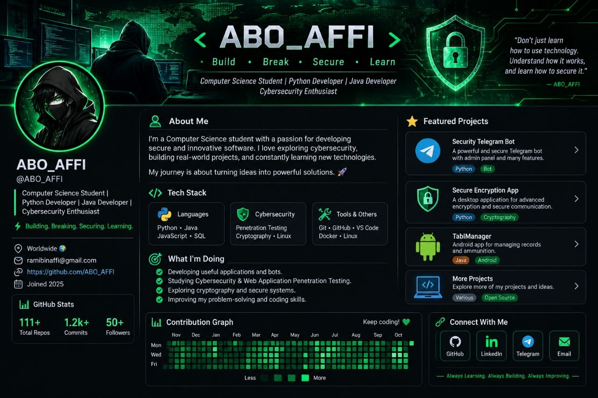

# ramibinaffi-lgmt

ABO_AFFI

Computer Science Student | Software Developer | Cybersecurity Enthusiast

Python Developer • Java Developer • Aspiring Penetration Tester

BUILD • EXPLORE • SECURE • LEARN

Understand technology. Build with purpose. Think securely.

---

👨‍💻 About Me

Hello! I'm a Computer Science student passionate about software development, cybersecurity, and understanding how technology works behind the scenes.

I enjoy building practical applications, exploring system architecture, solving programming problems, and continuously improving my technical skills.

My long-term goal is to become a well-rounded cybersecurity professional and penetration tester, combining strong software development knowledge with practical security skills.

What I Do

- 💻 Develop applications using Python and Java.
- 🔐 Explore cryptography and secure software development.
- 🛡️ Study cybersecurity and web application security.
- 🐧 Learn Linux, Bash, and system administration.
- 🌐 Explore networking and web technologies.
- 🚀 Build practical projects and document my learning journey.

---

🧰 Technical Skills & Technologies

Programming Languages

Development Tools

Operating Systems & Command Line

Databases & Other Technologies

---

🛡️ Cybersecurity Interests

I'm building my knowledge in information security through structured learning and practical experimentation.

Areas I'm interested in:

- Web Application Security
- Penetration Testing
- Linux Security
- Network Security
- Ethical Hacking
- Cryptography
- Secure Software Development
- Vulnerability Assessment

My focus is on learning security concepts responsibly and practicing only in authorized environments.

---

🎯 Current Learning Focus

Area| Current Focus
Python| Advanced programming and practical applications
Java| OOP and software development
Linux| Command line, file systems, permissions and processes
Networking| Network fundamentals and security
Web Security| Understanding web technologies and vulnerabilities
Cryptography| Modern encryption and secure communication
Penetration Testing| Methodologies, tools and authorized practice

---
🚀 Featured Projects

🤖 DemoAboAffi-bot

A Python-based Telegram bot prototype exploring interactive bot interfaces, service workflows, and Telegram Bot API integration.

Technologies: Python · Telegram Bot API

🔐 Secure Encryption System

A Python desktop application exploring secure communication, cryptographic identity management, digital signatures, and data protection.

Technologies: Python · Cryptography · Desktop GUI

📱 TablManager

An Android application for managing records, weapons, ammunition, and inventory operations.

Technologies: Java · Android SDK · SQLite

📚 Python Exercises

A collection of Python exercises, programming practice, and hands-on experiments.

Technologies: Python

«Some of my projects are still under development. I continuously improve their architecture, features, documentation, and code quality.»

---

📊 GitHub Statistics

---

🔥 Contribution Streak

---

🏆 GitHub Achievements

!GitHub Trophies](https://github-profile-trophy.vercel.app/?username=ramibinaffi-lgtm&theme=tokyonight&no-frame=true&no-bg=true&margin-w=8)

---

📈 Contribution Activity

---

🌐 Connect With Me

I'm always interested in learning, collaborating, exchanging ideas, and discussing software development and cybersecurity.

---

⚡ My Philosophy

Learn Deeply. Build Practically. Think Critically. Secure Everything.

Continuous Learning • Continuous Building • Continuous Improvement

Thank you for visiting my GitHub profile! 👋

